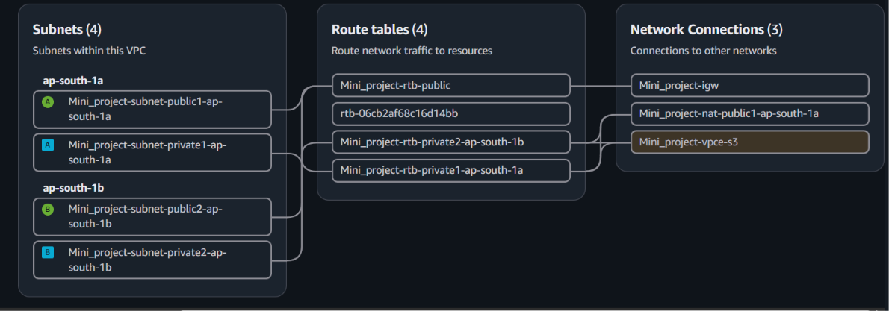
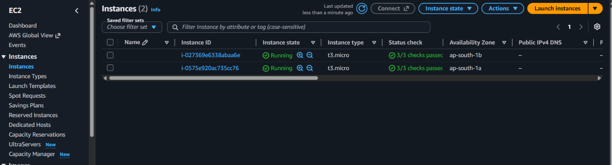
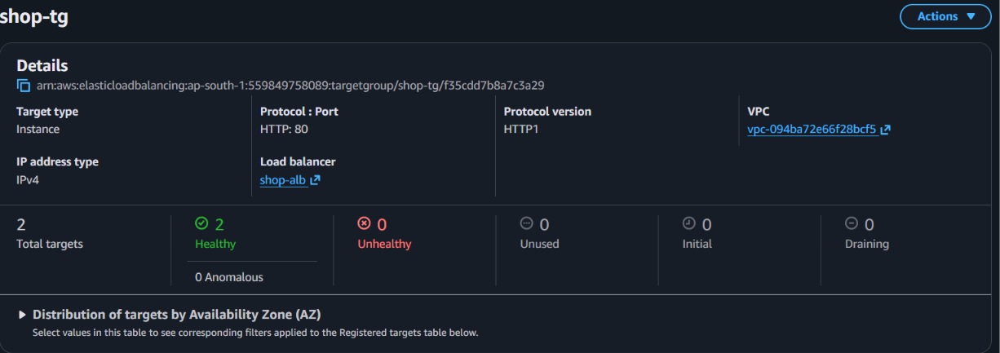
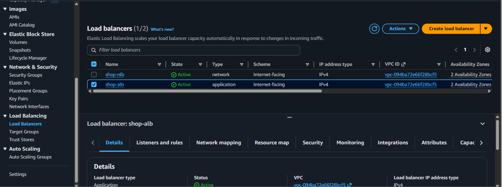
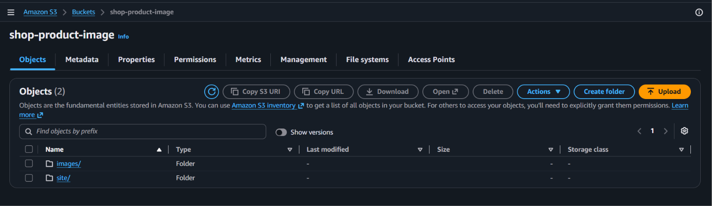
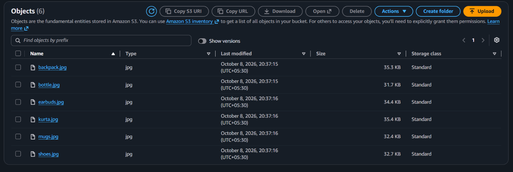
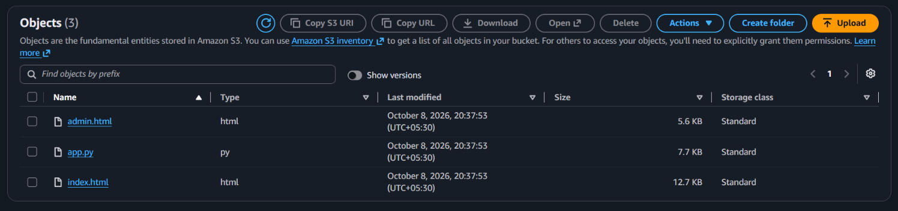
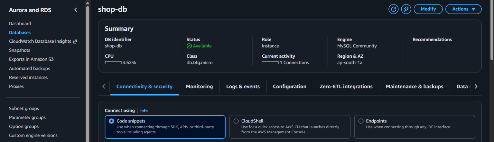
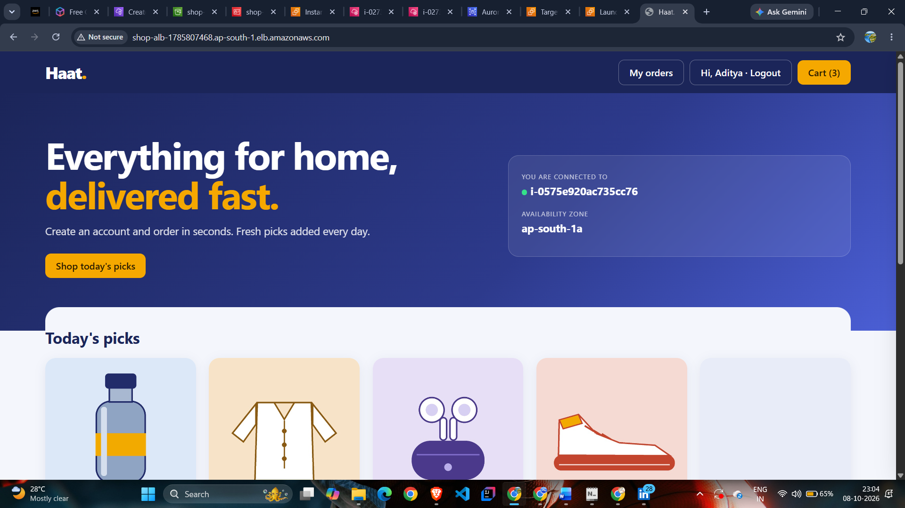
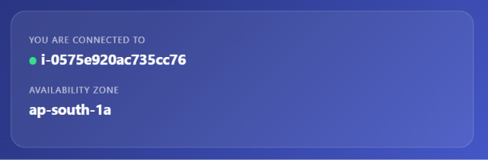

# Haat — Highly Available AWS E-Commerce Platform

**A cloud-hosted shopping application built using AWS services, with a focus on scalability, network security, availability, and cost optimization.**

## Project Overview

Haat is an AWS-based e-commerce mini project designed to demonstrate the deployment and management of a shopping application using cloud infrastructure.

The architecture uses a custom Amazon VPC across two Availability Zones in the Mumbai region (`ap-south-1`). It includes public and private subnets, load balancing, EC2 Auto Scaling, Amazon RDS for MySQL, Amazon S3, and scheduled EC2 shutdown automation using Amazon EventBridge and AWS Lambda.

## AWS Architecture Diagram


*The diagram illustrates the intended infrastructure layout and traffic flow for the Haat shopping platform.*

## AWS Services Used

| AWS Service | Purpose |
|---|---|
| Amazon VPC | Provides an isolated network for the application infrastructure. |
| Public and Private Subnets | Separate internet-facing resources from application resources. |
| Internet Gateway | Enables internet connectivity for appropriately routed public resources. |
| Application Load Balancer (ALB) | Distributes HTTP/HTTPS application traffic across registered targets. |
| Network Load Balancer (NLB) | Provides network-layer traffic distribution for the configured endpoints. |
| Amazon EC2 | Hosts the shopping application. |
| EC2 Auto Scaling | Maintains the configured instance capacity and scales according to its policies. |
| NAT Gateway | Provides outbound internet access for resources in private subnets. |
| Amazon RDS for MySQL | Provides managed relational database services for application data. |
| Amazon S3 | Stores product images and static application assets. |
| S3 VPC Gateway Endpoint | Enables private connectivity from the VPC to S3 without requiring an internet gateway or NAT for that traffic. |
| AWS IAM | Controls permissions for users, services, and automation. |
| Amazon EventBridge Scheduler | Triggers scheduled cloud operations. |
| AWS Lambda | Runs automation to stop EC2 instances during designated off-hours. |

## Architecture Details

### 1. Networking and VPC

- Region: Asia Pacific (Mumbai), `ap-south-1`.
- Two Availability Zones: `ap-south-1a` and `ap-south-1b`.
- Two public subnets for internet-facing load balancer resources.
- Two private subnets for the application tier.
- An Internet Gateway for public connectivity.
- A NAT Gateway for outbound internet connectivity from private resources.
- An S3 gateway endpoint for private access to S3.

### 2. Load Balancing and Auto Scaling

The architecture includes an Application Load Balancer named `shop-alb` and a Network Load Balancer named `shop-nlb`.

The application tier uses EC2 instances distributed across two Availability Zones.

The illustrated Auto Scaling configuration is:

- Instance type: `t3.micro`
- Minimum capacity: 2 instances
- Maximum capacity: 6 instances

Auto Scaling policies determine when capacity increases or decreases. Instance health checks and load balancer target health help maintain application availability.

### 3. Database Tier

Amazon RDS for MySQL (`shop-db`) provides the relational database layer.

- Illustrated instance class: `db.t4g.micro`
- Application resources connect to the database using the configured database endpoint.
- Database access should be restricted to authorized application security groups.
- Database credentials should be stored securely outside the source code.

### 4. Amazon S3 Storage

Amazon S3 stores product images and static application files.

An S3 VPC gateway endpoint provides private routing to S3 from the VPC. IAM policies, bucket policies, and endpoint policies should be configured to restrict access to the required resources.

### 5. Cost Optimization with Lambda and EventBridge

Amazon EventBridge Scheduler invokes an AWS Lambda function that stops designated EC2 instances during off-hours.

This automation is intended to reduce compute costs when the application is not required.

The schedule, Lambda execution role, target instance IDs, and shutdown behavior should be configured and tested before use. Stopping instances does not automatically eliminate charges for resources such as NAT Gateways, load balancers, or provisioned RDS storage.

## Application Features

The application is intended to provide online shopping functionality, including:

- Product browsing and product image display.
- User registration and authentication.
- Shopping cart and order management.
- Database-backed product and order information.
- AWS-hosted application infrastructure.

Actual application features should be verified against the included source code.

## Repository Structure

```text
AWS-Cloud-Project-Haat-e-commerce-website/
├── README.md
├── .gitignore
├── architecture/
│   └── haat-aws-architecture.png
├── screenshots/
│   ├── 01-vpc-subnets.png
│   ├── 02-ec2-instances.png
│   ├── 03-auto-scaling.png
│   ├── 04-load-balancer.png
│   ├── 05-rds-mysql.png
│   ├── 06-s3-bucket.png
│   └── 07-haat-application.png
└── src/
    └── application source files
```

*Adjust the folder and screenshot names to match the files actually committed to the repository.*

## Screenshots

## AWS Architecture

The Haat shopping platform uses AWS services to support application hosting, networking, scalability, database connectivity, object storage, and scheduled automation.


## AWS Infrastructure Screenshots

### 1. VPC and Subnets



### 2. EC2 Instances



### 3. Target Group Health



### 4. Load Balancer



### 5. Amazon S3

**S3 Bucket — Product and Application Storage**







### 6. Amazon RDS Database



## Application Screenshots

### Haat Shopping Website — View 1



### Haat Shopping Website — View 2




## Security Best Practices

- Use IAM roles and least-privilege permissions.
- Never commit AWS access keys, private keys, passwords, or production environment files.
- Restrict database inbound access to the application tier.
- Keep application instances in private subnets where appropriate.
- Use HTTPS and a valid TLS certificate for production traffic.
- Enable suitable database backups and recovery options.
- Review security groups, S3 bucket policies, and CloudWatch logs regularly.

## Deployment and Validation

The deployment process should include:

1. Configure the VPC, subnets, route tables, and gateways.
2. Configure security groups and IAM roles.
3. Deploy the application to EC2 instances.
4. Configure the load balancer listeners and target groups.
5. Configure the Auto Scaling Group and health checks.
6. Configure the RDS database and application connectivity.
7. Configure the S3 bucket and VPC gateway endpoint.
8. Configure and test EventBridge Scheduler and Lambda automation.
9. Validate application access, target health, database connectivity, and logs.

Detailed commands and configuration should be documented alongside the actual deployment scripts if they are included.

## Learning Outcomes

Through this project, I practised:

- Designing AWS VPC networking across multiple Availability Zones.
- Deploying and troubleshooting EC2-based applications.
- Configuring load balancing and Auto Scaling.
- Integrating an application with Amazon RDS and S3.
- Applying IAM and network access controls.
- Automating cloud operations using Lambda and EventBridge.
- Understanding AWS resource availability and cost optimization.

## Author

**Aditya Yadav**

GitHub: [aditya-yadav0808](https://github.com/aditya-yadav0808)

LinkedIn: [aditya-yadav-17b262290](https://linkedin.com/in/aditya-yadav-17b262290)

## Disclaimer

This project is intended for learning and portfolio purposes. The architecture diagram represents the planned design; individual services, availability configurations, and security controls should be verified against the actual deployed AWS environment.
