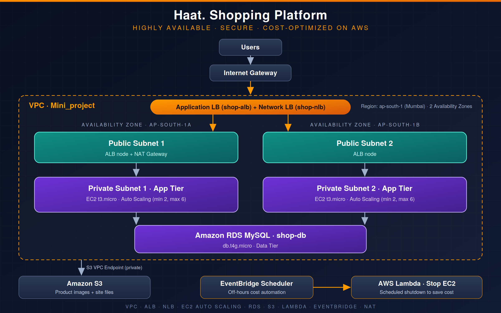

# Haat — AWS Shopping Website

## Project Overview

Haat is an online shopping application deployed using Amazon Web Services (AWS). This project demonstrates practical cloud computing concepts, including network design, application hosting, storage, database integration, scalability, and cloud resource management.

## AWS Architecture

The architecture is designed around a custom VPC spanning two Availability Zones, with public and private subnets. Compute, networking, application access, and data storage are organized according to the deployed configuration.

## AWS Services Used

- **Amazon VPC:** Network isolation and subnet configuration.
- **Amazon EC2:** Application hosting.
- **EC2 Auto Scaling:** Instance scaling and replacement.
- **Elastic Load Balancing:** Distributes traffic to registered targets, if configured.
- **Amazon RDS for MySQL:** Managed relational database.
- **Amazon S3:** Product image and application asset storage.
- **AWS IAM:** Identity and access management.
- **Amazon Route 53:** DNS management, if configured.
- **AWS Lambda and Amazon EventBridge:** Scheduled automation, if configured.

## Key Features

- Shopping application with product and order functionality.
- Database-backed application features.
- AWS-based application deployment.
- Network security and access control.
- Scalability and automation where configured.

## Repository Structure

- `architecture/` — AWS architecture diagram.
- `screenshots/` — Application and AWS console screenshots.
- `src/` — Application source code.

## Screenshots

### Shopping Application

### VPC and Networking

### Auto Scaling

### S3 Storage

## Deployment

The application source code and architecture documentation are included in this repository. Deployment instructions can be added based on the actual configuration and prerequisites.

## Security

- Do not commit AWS access keys, passwords, private keys, or production environment files.
- Prefer IAM roles and least-privilege permissions.
- Restrict database access to authorized resources.
- Review screenshots and logs for sensitive information.

## Learning Outcomes

- AWS networking and VPC configuration.
- EC2 hosting and troubleshooting.
- Load balancing and Auto Scaling concepts.
- RDS connectivity and S3 storage.
- IAM permissions and cloud operations.

## Author

Aditya Yadav

## Disclaimer

This project is for educational and portfolio purposes. The listed services and features should reflect the resources actually deployed and tested.
